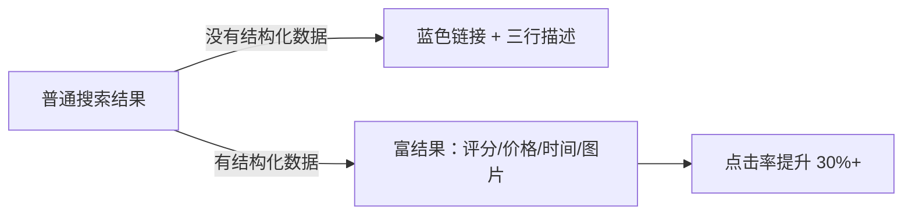

你可能遇到过这种情况：

在 Google 搜索一个问题，结果里直接显示了一个"问答卡片"——有标题、有答案、有评分。不需要点进网页就能看到答案。或者在搜菜谱时，搜索结果里直接展示了烹饪时间、卡路里数据。

这不是什么魔法，这是**结构化数据**的功劳。

**一句话理解：** 结构化数据就是用一种搜索引擎能"看得懂"的方式告诉它"这是一篇文章"、"这是一个产品"、"这是一个问题的答案"。

## 什么是结构化数据

常规的 HTML 标签（`div`、`p`、`h1`）只告诉浏览器"怎么展示内容"，但不告诉它"这是什么内容"。

结构化数据填补了这个空白。

```
普通 HTML：<h1>苹果</h1> → 搜索引擎猜："这大概是在说水果"
结构化数据：{"@type": "Product", "name": "苹果", "category": "水果"} 
→ 搜索引擎确定："这是一个叫'苹果'的产品，属于水果品类"
```

## 为什么 JSON-LD 是 2026 年的首选

结构化数据有三种格式：

| 格式 | 写法 | 推荐度 |
|------|------|:------:|
| JSON-LD | 用 `<script>` 标签嵌入 JSON | ✅ **强烈推荐** |
| Microdata | 在 HTML 标签上加属性 | ❌ 过时 |
| RDFa | 类似 Microdata 的扩展 | ❌ 小众 |

**Google 官方推荐使用 JSON-LD。** 2026 年没有任何理由再用 Microdata 或 RDFa 了。

```html
<!-- ✅ 2026 年推荐的做法：JSON-LD -->
<script type="application/ld+json">
{
  "@context": "https://schema.org",
  "@type": "Article",
  "headline": "SEO 结构化数据优化指南",
  "author": {
    "@type": "Person",
    "name": "飞鲤"
  },
  "datePublished": "2023-01-31",
  "dateModified": "2026-07-24",
  "image": "https://6mal.com/img/cover.jpg",
  "description": "结构化数据让搜索引擎更懂你的内容..."
}
</script>
```

把你的结构化数据放到页面的 `<head>` 或 `<body>` 末尾即可，不需要和实际展示内容耦合。

## 常见的结构化数据类型

### 文章（最常用，博客必备）

```json
{
  "@context": "https://schema.org",
  "@type": "Article",
  "headline": "文章标题",
  "description": "文章摘要",
  "author": {
    "@type": "Person",
    "name": "作者名"
  },
  "datePublished": "2023-01-31",
  "image": "https://example.com/cover.jpg"
}
```

### 面包屑导航（帮助搜索引擎理解层级）

```json
{
  "@context": "https://schema.org",
  "@type": "BreadcrumbList",
  "itemListElement": [
    {"@type": "ListItem", "position": 1, "name": "首页", "item": "https://6mal.com"},
    {"@type": "ListItem", "position": 2, "name": "Web开发", "item": "https://6mal.com/categories/web"},
    {"@type": "ListItem", "position": 3, "name": "这篇文章", "item": "https://6mal.com/archives/2/"}
  ]
}
```

### FAQ 页面（你的搜索结果会展示问答卡片）

```json
{
  "@context": "https://schema.org",
  "@type": "FAQPage",
  "mainEntity": [{
    "@type": "Question",
    "name": "什么是结构化数据？",
    "acceptedAnswer": {
      "@type": "Answer",
      "text": "结构化数据是用搜索引擎能理解的方式描述网页内容的标记方式。"
    }
  }]
}
```

### 产品（电商网站）

```json
{
  "@context": "https://schema.org",
  "@type": "Product",
  "name": "产品名称",
  "description": "产品描述",
  "offers": {
    "@type": "Offer",
    "price": "99.00",
    "priceCurrency": "CNY",
    "availability": "https://schema.org/InStock"
  }
}
```

## 怎么测试结构化数据

写完后一定要测试，不然你不知道写没写对。

- **Google Rich Results Test**：搜索"Rich Results Test"即可访问。输入 URL 或代码片段，它会告诉你结构化数据有没有被正确解析。
- **Google Search Console**：提交站点后，在"增强功能"板块可以看到哪些结构化数据被收录了、有没有错误。
- **百度资源平台**：百度也有结构化数据提交工具，可以在站长平台提交你的站点。

## 2026 年的建议

结构化数据不是"做了就排名第一"的魔法——但它确实能让你在搜索结果中更显眼。



根据 Google 的数据，带有结构化数据的搜索结果，**点击率平均提升 30%。** 这不是因为排名上升了，而是因为你的结果在页面上看起来更显眼。

### 我的建议

如果你是个人博客，至少加上 `Article` 和 `BreadcrumbList` 两个结构化数据类型——它们对所有内容类网站都适用，而且配置非常简单。

这个博客的所有文章页面都嵌入了 JSON-LD 结构数据，如果你查看页面源代码，能看到完整的实现。

## 相关推荐

- [Meta 标签功能大全——你可能不知道的 20 种用法](/archives/6/)
- [真正能提高网站流量的方法——2026 年 SEO 策略](/archives/10/)
- [如何给你的网站添加 OG 标签——Open Graph 实战指南](/archives/29/)

**P.S.** 我第一次配置结构化数据时犯了最蠢的错误——把 `@type: Article` 写成了 `@type: "Aritcle"`（少了个 e）。Google Rich Results Test 直接报错。修改后重新提交，第二天就在搜索结果里看到了"富结果"展示——**那种感觉就像你的网站在搜索结果里"发光"了。**
