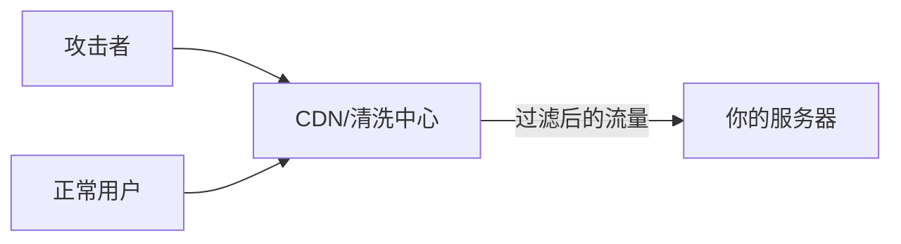

几年前我的一个小网站突然打不开了。

上去一看服务器——CPU 100%，带宽跑满，连接数爆表。登录 SSH 都卡得不行。

当时的感受就是四个字：**束手无策。**

我一直等，等攻击停了，才恢复正常。但接下来一周，同样的攻击来了三次。

那时候我才认真研究 DDoS 防御，发现了一个残酷的事实：**个人站长在 DDoS 面前，和你网站的规模、技术实力没任何关系——只和你有没有上保护有关系。**

**一句话理解：** DDoS 攻击不是"黑客攻破你的网站"，而是"黑客叫了一万个人堵在你店门口，真正的顾客进不来"。

## 什么是 DDoS 攻击

DDoS（Distributed Denial of Service，分布式拒绝服务攻击）的原理很简单：

攻击者控制大量"肉鸡"（被感染的电脑、IoT 设备等），让它们同时向你的服务器发送请求——你的服务器处理不过来，正常用户就访问不了了。

传统上分为两类：

| 攻击类型 | 攻击层面 | 典型方式 |
|---------|---------|---------|
| 网络层攻击（L3/L4） | 带宽和连接 | SYN Flood、ICMP Flood、UDP Flood |
| 应用层攻击（L7） | HTTP 请求 | HTTP Flood、Slowloris、API 滥用 |

2026 年的 DDoS 攻击有两个明显趋势：
- **攻击规模越来越大**：最新的反射放大攻击可以达到 Tbps 级别
- **应用层攻击越来越多**：模仿正常用户的 HTTP 请求更难防御

## 2026 年的防御方案：别自己扛

原文建议的方案（更多服务器、防火墙过滤、手动封 IP）在 2026 年已经不太实用了。

现代的 DDoS 防御思路核心是：**把你的服务放到一个"清洗中心"后面。**

### 方案一：CDN + DDoS 防护服务（最推荐）

Cloudflare、AWS Shield、Azure DDoS Protection、GCP Cloud Armor 等云服务商提供的 DDoS 防护是目前最有效的方案。



CDN 服务的原理是：
1. 所有流量先到 CDN 的边缘节点
2. CDN 在边缘层识别并过滤攻击流量
3. 只有正常的请求才转发到你的源服务器

以 Cloudflare 为例：

```
用户 → Cloudflare 边缘节点（全球 300+ 节点）
                    ↓
            Cloudflare 检测异常流量
                    ↓
         正常请求 → 你的源服务器
         攻击请求 → 在边缘丢弃
```

这样做的最大好处是：**你的源服务器 IP 根本不暴露给外界。** 攻击者不知道你的真实 IP，就没办法直接攻击你的服务器。

### 方案二：Web 应用防火墙（WAF）

WAF 是应用层 DDoS 防御的核心工具。它可以基于规则和机器学习识别恶意请求模式。

```nginx
# Nginx WAF 配置片段——限制请求速率
limit_req_zone $binary_remote_addr zone=api:10m rate=10r/s;

location /api/ {
    limit_req zone=api burst=20 nodelay;
    
    # 返回 429 表示请求过载
    limit_req_status 429;
}
```

WAF 可以做的事：
- 限流（Rate Limiting）：限制单个 IP 的请求频率
- IP 黑/白名单
- 地理封锁：如果不是你的业务地区，直接拦截
- 挑战验证：返回 CAPTCHA 或 JS 挑战，验证请求是否来自真实浏览器

> **经验之谈：** 有一次我的 API 被刷了——不是 DDoS，是有个爬虫脚本疯狂请求我的数据接口。我在 Nginx 配了 `limit_req`，限到每秒 5 次。爬虫瞬间从每秒 1000 次降到 5 次，服务器负载从 80% 降到了 5%。**很多时候你不需要复杂的方案，一个限流配置就够了。**

### 方案三：自动扩容 + 弹性架构

如果你的业务对可用性要求非常高，可以设计自动扩容架构：

```yaml
# Kubernetes 自动扩容配置示例
apiVersion: autoscaling/v2
kind: HorizontalPodAutoscaler
metadata:
  name: web-app
spec:
  scaleTargetRef:
    apiVersion: apps/v1
    kind: Deployment
    name: web-app
  minReplicas: 3
  maxReplicas: 50
  metrics:
  - type: Resource
    resource:
      name: cpu
      target:
        type: Utilization
        averageUtilization: 70
```

这样在攻击来临时，系统会自动增加实例来吸收流量。但当攻击流量超过预算上限时，仍然需要 CDN 防护来兜底。

## 2026 年 DDoS 防御方案对比

| 方案 | 成本 | 防御能力 | 复杂度 | 推荐场景 |
|------|------|---------|--------|---------|
| Cloudflare Free/Pro | 免费~$20/月 | L3/L4 基本防护 | 低 | 个人站、博客 |
| Cloudflare Enterprise | $200+/月 | L7 全面防护 | 低 | 商业站点 |
| AWS Shield Standard | 免费 | L3/L4 基础防护 | 低 | AWS 用户 |
| AWS Shield Advanced | $3000/月 | 全面防护+费用保护 | 中 | 大型业务 |
| 自建 Nginx 限流 | 免费 | 只能防应用层 | 高 | 补充方案 |
| 自建硬件防火墙 | 高 | 取决于设备 | 高 | 大企业 |

对于 90% 的个人网站和中小型企业来说，**Cloudflare 免费版 + Nginx 基本限流**已经足够应对大部分攻击了。

## 到底什么才是"防住了"

DDoS 防御的目标不是"完全阻止攻击"——那是做不到的。真正的目标是**让你的服务在攻击期间仍然可用。**

| 防御等级 | 效果 |
|---------|------|
| 没防护 | 攻击 1 分钟网站就挂了 |
| 基础 CDN | 中小型攻击被消化，大流量攻击影响部分地区 |
| 全面防护 | 大部分攻击被边缘拦截，用户无感知 |
| 企业级防护 | Tbps 级攻击也能扛住，但成本极高 |

## 相关推荐

- [网站常见安全漏洞与防范](/archives/0015/)
- [什么是 SSL 和 HTTPS？网站加密入门](/archives/0026/)
- [网页打开太慢？2026 年的性能优化方案](/archives/0021/)

**P.S.** 回到开头那个被攻击的故事——后来我做了什么？我花了一下午把网站接上了 Cloudflare，开启了 Under Attack 模式。之后再遇到 DDoS，攻击流量全部打在 Cloudflare 的边缘节点上，我的服务器一点感觉都没有。**上了一个 CDN，从此再没被 DDoS 搞垮过。** 有时候，最好的代码就是不用自己写的代码。
