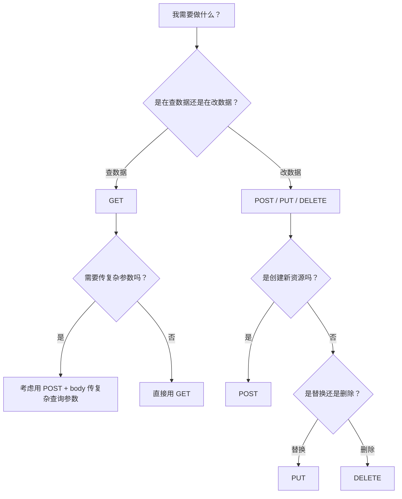

面试前端的时候，有一个问题几乎必问——**"GET 和 POST 有什么区别？"**

我发现大部分人回答这个问题的时候，像在背一段写好的稿子：

"GET 参数在 URL 里，POST 参数在 body 里……GET 会被缓存，POST 不会……GET 有长度限制，POST 没有……"

然后面试官追问一句："那 HTTP 协议里 GET 和 POST 本质的区别是什么？"

对方愣住了。

**一句话理解：** GET 是"我去拿个东西"，POST 是"我送个东西过去并请你处理"——它们在 HTTP 协议层面的底层机制是一样的，但语义（以及随之而来的浏览器行为）完全不同。

## 先来涨涨知识：什么不是 GET 和 POST 的区别？

网上流传的那些"区别"，大部分其实是**浏览器的约定和习惯**，不是 HTTP 协议本身的要求。

| 说法 | 实际情况 |
|------|---------|
| GET 参数在 URL，POST 在 body | HTTP 协议没有禁止 GET 带 body，也没有禁止 POST 带 URL 参数 |
| GET 有长度限制 | HTTP 协议本身没有长度限制，是浏览器和服务器的实现约束 |
| POST 更安全 | 参数不在 URL 上不等于安全——HTTPS 才是保证传输安全的正确方式 |
| POST 不能被缓存 | 实际上 POST 也可以被缓存，只是很少有浏览器实现 |

当年有一篇很火的文章说 GET 只发一个 TCP 包，POST 发两个——这个说法在 HTTP/1.1 时代就有些牵强，到了 HTTP/2 和 HTTP/3 时代更是完全不成立了。

## 真正的区别：语义

GET 和 POST 的**本质区别**不是技术实现，而是**语义**。

- **GET 意味着"取资源"**——它应该是安全的（不改变服务器状态）、幂等的（多次请求结果一致）、可缓存的
- **POST 意味着"提交处理"**——它既不安全也不幂等，每次请求都可能改变服务器状态

```http
// GET：我需要这个资源
GET /archives/40/ HTTP/1.1
Host: 6mal.com

// POST：我创建了一个新资源
POST /api/articles HTTP/1.1
Host: 6mal.com
Content-Type: application/json

{"title": "GET vs POST", "content": "..."}
```

> **经验之谈：** 我在写第一个 API 接口时，把所有接口都用了 POST——因为"反正 POST 可以传更多数据"。后来被同事 review 的时候骂了一顿：查数据的接口用 GET，才能利用 CDN 和浏览器缓存，减少不必要的请求。那次 review 让我明白了一个道理——**协议不是摆设，设计的人已经考虑好了不同的用途。**

## GET 的特质：安全、幂等、可缓存

"安全"（Safe）：GET 请求不会修改服务器上的任何数据。它就像你站在图书馆的书架前翻书——你的操作不会改变书的内容。

"幂等"（Idempotent）：同一个 GET 请求无论发多少次，结果都是一样的。发 1 次和发 100 次，服务器上的数据不会多也不会少。

"可缓存"（Cacheable）：浏览器和 CDN 知道 GET 请求是安全的，所以可以放心地缓存返回结果——下次再请求同一个 URL 时，直接从缓存拿，不用去服务器。

```bash
# 第 1 次：去服务器请求
curl https://6mal.com/archives/40/  # 200 OK

# 第 2 次：浏览器直接从缓存取
# 点击同一个链接 → 浏览器缓存命中 → 几乎瞬间展示
```

## POST 的特质：不安全、非幂等、不可缓存

"不安全"：POST 请求通常意味着**数据会被修改**。提交表单、创建文章、下单——这些都是 POST 的干的事。

"非幂等"：同一个 POST 请求发两次，可能会有完全不同的结果。

```http
// 第一次 POST → 成功创建
POST /api/articles HTTP/1.1
{"title": "GET vs POST"}
→ 201 Created, id: 123

// 第二次 POST → 又创建了一个
POST /api/articles HTTP/1.1
{"title": "GET vs POST"}
→ 201 Created, id: 124  // 多了一条重复记录
```

这也是为什么浏览器在刷新 POST 页面时会弹提示"是否重新提交表单"——因为浏览器自己也不知道重发一次会不会闯祸。

## 那 PUT、PATCH、DELETE 呢？

GET 和 POST 只是 HTTP 方法家族里的两个成员。完整的 RESTful 设计通常是：

| 方法 | 作用 | 是否安全 | 是否幂等 |
|------|------|---------|---------|
| GET | 获取资源 | ✅ | ✅ |
| POST | 创建资源 | ❌ | ❌ |
| PUT | 替换资源 | ❌ | ✅ |
| PATCH | 部分更新 | ❌ | ❌（视实现而定） |
| DELETE | 删除资源 | ❌ | ✅ |

注意 PUT 和 DELETE 虽然"不安全"（会修改数据），但是"幂等"的——发 1 次和发 100 次 DELETE，结果都是资源被删除。

## HTTP/2 和 HTTP/3 带来的变化

前面提到"GET 一个包、POST 两个包"的说法已经过时了。在 HTTP/2 和 HTTP/3 中，情况更复杂：

- **HTTP/2**：所有请求都在同一个 TCP 连接上复用（多路复用），"一个包"和"两个包"的区别完全不存在了
- **HTTP/3**：改用 QUIC（基于 UDP），TCP 的概念本身都被颠覆了

所以说，**不要拿 TCP 层面的细节来区分 GET 和 POST**。正确的区分方式是**从语义角度**。

## 一个真实场景

我之前设计过一个 API：获取文章的详情。

正常思路是用 `GET /api/articles/123`。但我接手的项目是这么写的：`POST /api/article_detail`，body 里传文章 ID。

我问为什么要用 POST，对方说"用习惯了"。

后来这个接口需要被 CDN 缓存来加速——因为走的是 POST，无法缓存。不得不又写了一个 GET 接口来支持 CDN。

**多写一个接口的代价不大，但多浪费一次思考的代价是——你在设计阶段就没有想到"缓存"这件事。**

## 2026 年怎么选



当然，如果你的 API 完全用的是 GraphQL（所有请求都走 POST），以上这些全都不适用。GraphQL 就是另一种思路了——把方法和路由的选择权交给客户端。

## 相关推荐

- [标记语言、脚本语言、编译语言的区别——理清你的技术栈](/archives/39/)
- [12 种最常用的网页编程语言——2026 年最新排名](/archives/41/)
- [判断一个网站是由哪种语言开发的](/archives/31/)

**P.S.** 每次面试问完这个问题的候选人，我都会再问一句："那你知道 OPTIONS 请求是干嘛的吗？"大部分人又卡住了。所以这篇文章其实只说了 REST 里最基础的四个动词——HTTP 其实定义了 9 种方法，还有 HEAD、OPTIONS、TRACE、CONNECT 没讲。你如果能把 GET 和 POST 的区别说清楚，已经超越了 90% 的面试者了。
